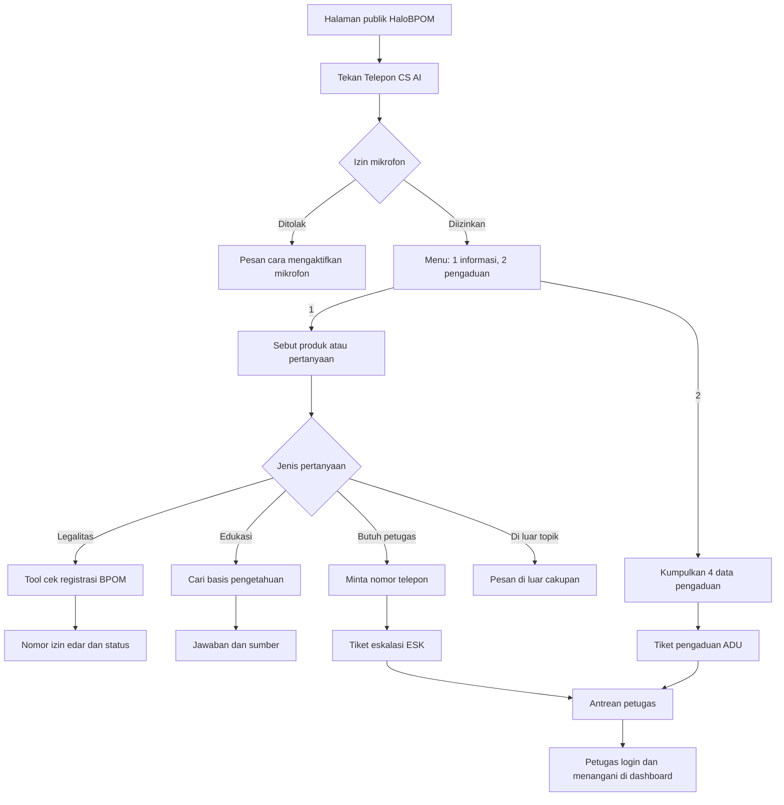
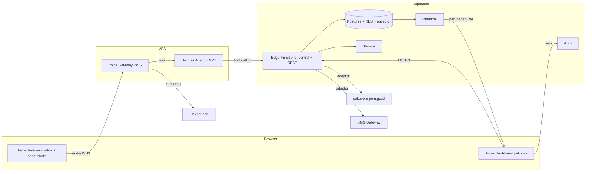
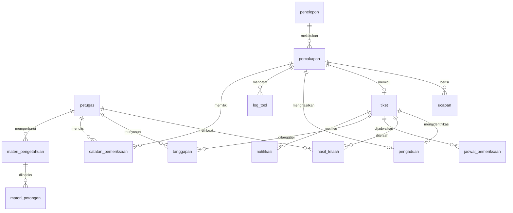

# SIGAP: Sistem Informasi dan Gerbang Aduan Publik

SIGAP adalah AI Voice Agent untuk kanal layanan HaloBPOM milik Badan Pengawas Obat dan Makanan (BPOM). Masyarakat menekan tombol **"Telepon CS AI"** di situs HaloBPOM, lalu berbicara langsung dengan agen suara yang:

- menjawab **legalitas produk** (nomor izin edar dan status izin) dari data registrasi resmi BPOM;
- menjawab **pertanyaan edukasi** obat dan makanan dari basis pengetahuan, selalu dengan sumber rujukan;
- **mencatat pengaduan** produk sampai lengkap, lalu menerbitkan nomor tiket;
- **meneruskan ke petugas** pertanyaan yang butuh penilaian manusia, misalnya nasihat medis, dengan tiket eskalasi.

Petugas HaloBPOM memakai dashboard web untuk memantau layanan secara live, membaca transkrip, menangani pengaduan sampai tiket ditutup, mengelola basis pengetahuan, dan mengunduh laporan.

Proyek ini dikerjakan untuk mata kuliah Pengembangan Perangkat Lunak (PPL) Praktikum kelas I4, S1 Sistem Informasi, FST Universitas Airlangga, oleh Kelompok 2: Hariz Fauzil Adhim, Adrian Faishal Hilmy, Thoriq Rafi Al Bani, dan Kevin Brawijaya.

## Daftar Isi

- [Latar Belakang](#latar-belakang)
- [Pengguna](#pengguna)
- [Fitur](#fitur)
- [Alur Pengguna](#alur-pengguna)
- [Arsitektur](#arsitektur)
- [Tech Stack dan Alasannya](#tech-stack-dan-alasannya)
- [Skema Database](#skema-database)
- [Aturan Bisnis](#aturan-bisnis)
- [Target Kinerja](#target-kinerja)
- [Rencana Rilis](#rencana-rilis)
- [Struktur Repo](#struktur-repo)
- [Memulai](#memulai)
- [Aturan Kontribusi](#aturan-kontribusi)

## Latar Belakang

HaloBPOM melayani informasi dan pengaduan lewat telepon 1500533, pesan, surel, dan media sosial. Banyak pertanyaan sebenarnya bisa dijawab dari data publik seperti cekbpom.pom.go.id, tetapi penelepon tetap menghubungi petugas. Akibatnya:

- pertanyaan rutin mengantre bersama pengaduan yang benar-benar butuh penilaian manusia;
- pengaduan masuk dengan data tidak lengkap sehingga petugas perlu bolak-balik menghubungi pelapor;
- percakapan dan tindak lanjut tidak terekam secara terstruktur.

SIGAP menjawab pertanyaan rutin secara instan dari sumber resmi, sehingga antrean petugas hanya berisi kasus yang memang butuh manusia.

**Di luar cakupan versi 1:** nasihat medis otomatis, keputusan tindak lanjut pengaduan secara otomatis, integrasi telepon PSTN 1500533 (akses hanya lewat browser), manajemen akun petugas, dan bahasa selain Indonesia.

## Pengguna

| Pengguna | Karakteristik | Akses |
|---|---|---|
| Penelepon | Masyarakat umum dengan literasi digital beragam, tanpa login. Menu suara dibuat hanya dua pilihan dengan bahasa sehari-hari. | Publik |
| Petugas HaloBPOM | Pegawai BPOM yang memakai dashboard setiap hari kerja. | Login email dan password |
| Petugas berhak ekspor | Sebagian petugas yang boleh mengunduh laporan. | Login + flag `hak_ekspor` |

## Fitur

Versi pertama mencakup delapan use case dari SRS v1.0, ditambah tampilan status AI Agent di dashboard.

| Kode | Use case | Pengguna | Ringkasan |
|---|---|---|---|
| UC-01 | Menanyakan Informasi Produk | Penelepon | Cek legalitas lewat tool calling, jawaban edukasi bersumber, eskalasi ke petugas |
| UC-02 | Menyampaikan Pengaduan Produk | Penelepon | Kumpulkan nama produk, kronologi, nama, dan nomor telepon, lalu terbitkan tiket |
| UC-03 | Melakukan Login Dashboard | Petugas | Login, kunci akun setelah 3 kali gagal, sesi berakhir setelah 30 menit idle |
| UC-04 | Memantau Layanan | Petugas | Ringkasan statistik, panggilan berjalan live, antrean tiket eskalasi, status AI Agent |
| UC-05 | Membaca Transkrip Percakapan | Petugas | Riwayat per periode, transkrip dengan data pribadi tersamarkan, catatan pemeriksaan |
| UC-06 | Menangani Pengaduan | Petugas | Telaah, jadwal pemeriksaan, tanggapan resmi, tutup tiket dengan SMS ke pelapor |
| UC-07 | Mengelola Basis Pengetahuan | Petugas | Tambah materi bersumber, nonaktifkan tanpa hapus permanen, graf pengetahuan |
| UC-08 | Merekap dan Mengunduh Laporan | Petugas | Rekap per periode, unduh PDF atau CSV bagi petugas berhak ekspor |

Status pengaduan berjalan berjenjang: **Belum Ditelaah → Sedang Ditelaah → Menunggu Pemeriksaan → Tanggapan Disusun → Selesai**, dengan cabang **Diteruskan ke Instansi Lain** untuk pengaduan di luar kewenangan BPOM.

Halaman yang dibangun:

| Halaman | Rute | UC |
|---|---|---|
| Halaman Publik HaloBPOM + Panel Percakapan Suara | `/homepage` | UC-01, UC-02 |
| Login Petugas | `/login` | UC-03 |
| Ringkasan Layanan | `/ringkasan` | UC-04 |
| Panggilan Berjalan | `/panggilan-berjalan` | UC-04 |
| Tiket Eskalasi | `/tiket-eskalasi` | UC-04 |
| Riwayat Percakapan + Detail Transkrip | `/riwayat-percakapan` | UC-05 |
| Daftar Pengaduan + Detail Pengaduan | `/pengaduan` | UC-06 |
| Basis Pengetahuan | `/basis-pengetahuan` | UC-07 |
| Rekap dan Laporan | `/rekap-laporan` | UC-08 |

## Alur Pengguna

Penelepon membuka halaman publik, menekan "Telepon CS AI", dan mengizinkan mikrofon. Agen memutar menu "Tekan 1 untuk informasi produk, tekan 2 untuk pengaduan." Ucapan penelepon dan jawaban agen tampil di transkrip langsung, sehingga penelepon dengan gangguan pendengaran tetap bisa membaca jawabannya.



## Arsitektur

SIGAP memakai arsitektur berlapis:

1. **Presentasi (Astro).** Halaman publik dengan panel panggilan suara dan dashboard petugas.
2. **Layanan suara.** *Voice Gateway*, layanan Node kecil, menerima audio mikrofon lewat WebSocket Secure, meneruskannya ke ElevenLabs Speech-to-Text secara streaming, mengirim teks ke Hermes Agent, lalu mengalirkan balik suara dari ElevenLabs Text-to-Speech.
3. **Agen AI.** Hermes Agent menjalankan model GPT, menyusun jawaban, dan memanggil tool SIGAP: `cek_registrasi_bpom`, `cari_basis_pengetahuan`, `terbitkan_tiket_eskalasi`, dan pencatatan pengaduan.
4. **Backend (Supabase).** Edge Functions menjadi lapisan control dan REST API. Postgres menyimpan seluruh data dengan Row Level Security, pgvector menyimpan indeks RAG, Realtime mengalirkan data live ke dashboard, Auth menangani sesi petugas, dan Storage menyimpan berkas laporan.



Kode dipisah menurut pola **Boundary, Control, Entity** (NFR-18):

| Lapisan | Isi di SIGAP |
|---|---|
| Boundary | Halaman dan komponen Astro, endpoint Edge Functions |
| Control | Modul use case di Edge Functions dan layanan agen, misalnya `PengaduanController` dan `BasisPengetahuanController` |
| Entity | Tabel Postgres beserta enum status dan constraint |

Semua layanan eksternal (cekbpom, LLM, STT, TTS, SMS Gateway, embedding) diakses lewat **adapter** yang punya implementasi produksi dan implementasi tiruan (mock). Dengan begitu penyedia bisa diganti tanpa menyentuh kode use case, dan tim tetap bisa mengembangkan serta mendemokan sistem walaupun akses resmi cekbpom dan SMS Gateway belum tersedia.

## Tech Stack dan Alasannya

Keputusan lengkap ada di [ADR 0001](docs/decisions/0001-stack.md).

| Lapisan | Pilihan | Alasan |
|---|---|---|
| Frontend | **Astro + TypeScript** | Halaman dirender di server, bagian interaktif (panel suara, tabel live, formulir) memakai *island*. Halaman publik tetap ringan untuk masyarakat dengan perangkat beragam, dashboard cukup interaktif tanpa harus menjadi SPA penuh. Cocok untuk tim dengan pengalaman menengah. |
| Backend | **Supabase** | Satu platform menyediakan semua yang dibutuhkan dashboard: Postgres, Auth untuk sesi petugas, Realtime untuk dashboard live (UC-04), Storage untuk berkas laporan (UC-08), dan Edge Functions untuk aturan bisnis. Jauh lebih sedikit kode dibanding membangun backend sendiri. |
| Database | **Postgres + pgvector + RLS** | Data layanan bersifat relasional (percakapan, tiket, pengaduan, tanggapan), dan status butuh constraint yang ketat. pgvector membuat indeks RAG berada di database yang sama dengan materinya, sehingga materi yang dinonaktifkan langsung tidak ikut dicari. Row Level Security menjaga akses di tingkat baris. |
| Agen AI | **Hermes Agent + model GPT (langganan)** | Mendukung pengenalan maksud, RAG, dan *tool calling*. Tool calling penting karena status legalitas produk wajib berasal dari data registrasi, tidak boleh dibangkitkan model (NFR-7). |
| STT dan TTS | **ElevenLabs API** | Mendukung streaming dua arah untuk mengejar target jawaban ≤ 3 detik. Belum ada data uji yang menunjukkan penyedia lain lebih akurat untuk bahasa Indonesia. |
| Deployment | **VPS Linux di Indonesia (Docker + Nginx)** | Menjalankan Astro, Voice Gateway, dan Hermes Agent. Nginx menjadi reverse proxy HTTPS dan WSS. |

### Mengapa Astro, bukan framework JavaScript lain?

SIGAP punya dua wajah dengan kebutuhan yang berbeda. Halaman publik HaloBPOM dibuka masyarakat umum, sering lewat ponsel dan koneksi seadanya. Dashboard petugas dipakai setiap hari kerja dan butuh komponen interaktif. Astro dipilih karena bisa melayani keduanya dari satu proyek tanpa membebani salah satunya.

1. **JavaScript hanya dikirim ke bagian yang butuh.** Dengan arsitektur *islands*, halaman Astro dikirim sebagai HTML statis. Hanya komponen interaktif seperti panel panggilan suara, tabel live, dan formulir yang membawa JavaScript ke browser. Framework SPA seperti React + Vite, Vue, atau Angular mengirim seluruh runtime dan kode aplikasi walaupun sebagian besar halaman hanya menampilkan teks. Untuk halaman publik, ini berarti waktu muat lebih cepat di ponsel, sesuai target dashboard ≤ 3 detik pada 10 Mbps (NFR-3).
2. **Backend sudah ditangani Supabase.** Next.js, Nuxt, dan SvelteKit kuat karena fitur full-stack: API route, server actions, dan middleware data. Di SIGAP, autentikasi, database, realtime, penyimpanan berkas, dan aturan bisnis sudah ada di Supabase (Auth, Postgres + RLS, Realtime, Storage, Edge Functions). Memakai framework full-stack berarti membawa lapisan backend kedua yang tumpang tindih. Astro cukup menjadi lapisan tampilan, sesuai peran *Boundary* di pola BCE.
3. **Render di server untuk pemeriksaan sesi.** Astro mendukung server-side rendering, sehingga setiap halaman dashboard bisa memeriksa sesi petugas di server sebelum halaman dikirim. Ini sesuai aturan keamanan proyek bahwa otorisasi dilakukan di server, bukan dengan menyembunyikan menu (PROJECT_RULES bagian 5). SPA murni hanya bisa memeriksa sesi setelah JavaScript termuat di browser.
4. **Tidak mengunci tim ke satu library UI.** Island Astro bisa ditulis dengan komponen `.astro` biasa, atau dengan React, Svelte, maupun Vue bila suatu komponen butuh state yang rumit, misalnya panel suara atau graf pengetahuan. Anggota tim bisa memakai library yang paling mereka kuasai tanpa mengganti framework.
5. **Kurva belajar landai untuk tim menengah.** Komponen `.astro` pada dasarnya HTML + CSS dengan bagian skrip di atasnya. Konsepnya lebih sedikit dibanding App Router Next.js (server/client component, caching bertingkat, server actions), jadi tim bisa fokus ke fitur dalam tiga sprint yang tersedia.
6. **TypeScript bawaan.** Astro mendukung TypeScript tanpa konfigurasi tambahan, sehingga satu bahasa dipakai dari halaman sampai Edge Functions.

| Framework | Kenapa tidak dipilih untuk SIGAP |
|---|---|
| Next.js (React) | Fitur full-stack-nya tumpang tindih dengan Supabase. Mengirim runtime React ke setiap halaman, dan model server/client component menambah kompleksitas yang tidak dibutuhkan. |
| React + Vite (SPA) | Semua halaman dirender di browser, sehingga halaman publik lebih berat dan pemeriksaan sesi baru terjadi setelah JavaScript termuat. |
| Nuxt (Vue) / SvelteKit | Sama-sama framework full-stack yang bagus, tetapi lapisan server-nya juga tumpang tindih dengan Supabase. Keunggulan islands Astro untuk halaman publik yang ringan tidak didapat secara bawaan. |
| Angular | Terlalu berat untuk ukuran proyek dan durasi tiga sprint. Kurva belajarnya paling curam. |

Kelemahan Astro yang disadari: bagian yang sangat interaktif tetap butuh komponen island, dan pembaruan live dari Supabase Realtime harus ditangani di dalam island tersebut. Untuk ukuran SIGAP, hal ini masih sepadan dengan keuntungan halaman yang ringan.

**Alternatif yang dipertimbangkan:**

- *Backend kustom (Laravel, sesuai SRS yang menyebut Behat).* Ditolak karena autentikasi, realtime, dan penyimpanan berkas harus dibangun sendiri, padahal Supabase sudah menyediakannya.
- *Penyedia STT/TTS lain.* Belum ada hasil uji akurasi bahasa Indonesia yang lebih baik dari ElevenLabs.

**Konsekuensi yang harus ditangani:**

- Penguncian akun setelah tiga kali gagal (REQ-3.5) tidak ada bawaan di Supabase Auth, jadi dibuat sendiri lewat Edge Function login.
- Setiap tabel wajib dijaga Row Level Security. Kunci `service_role` hanya dipakai di sisi server.
- Model GPT diakses lewat langganan, jadi syarat layanan dan kuotanya harus dipastikan. Bila tidak memadai, cukup ganti adapter LLM ke OpenAI API.
- SRS mensyaratkan data disimpan di Indonesia (UU No. 27 Tahun 2022 tentang PDP). Supabase belum punya region Indonesia (terdekat Singapura), jadi sebelum produksi lokasi data harus dikonfirmasi ke dosen atau BPOM, atau Supabase di-self-host di server Indonesia.
- Behat (PHP) tidak cocok dengan stack TypeScript. Kerangka uji penerimaan Gherkin (misalnya Playwright + Cucumber) ditetapkan lewat ADR berikutnya.

## Skema Database

Database adalah Postgres milik Supabase. Migrasi dikelola lewat Supabase CLI.

### Akun dan identitas

| Tabel | Kolom utama | Catatan |
|---|---|---|
| `petugas` | `id uuid` (sama dengan `auth.users`), `nama`, `email` (unik), `hak_ekspor boolean`, `gagal_login int`, `terkunci_sampai timestamptz`, `aktif boolean` | Menyimpan penghitung gagal login untuk penguncian akun. Fungsi helper `is_petugas()` dipakai kebijakan RLS seluruh tabel dashboard. |
| `penelepon` | `id uuid`, `no_telp`, `nama_pelapor`, `nik_pelapor` (nullable) | Hanya dibuka oleh Edge Functions. Dashboard membaca view `penelepon_tersamar` yang mengembalikan nama dan nomor yang sudah disamarkan. |

### Percakapan

| Tabel | Kolom utama | Catatan |
|---|---|---|
| `percakapan` | `id`, `penelepon_id` (nullable), `waktu_mulai`, `waktu_selesai`, `jenis_interaksi` enum (`informasi_produk`, `pengaduan`), `status_penyelesaian` enum (`berjalan`, `selesai_ai`, `dieskalasi`, `tiket_terbit`, `pengaduan_tidak_lengkap`), `tahap_ai`, `topik`, `ringkasan` | Satu baris per sesi panggilan. Diindeks pada `waktu_mulai` dan `status_penyelesaian`. |
| `ucapan` | `percakapan_id`, `urutan`, `pembicara` enum (`sistem`, `penelepon`), `teks`, `detik_ke` | Transkrip per baris ucapan. |
| `log_tool` | `percakapan_id`, `nama_tool`, `durasi_ms`, `berhasil`, `waktu` | Rekam pemanggilan tool agen untuk halaman AI Agent. |

### Tiket dan penanganan pengaduan

| Tabel | Kolom utama | Catatan |
|---|---|---|
| `tiket` | `id`, `no_tiket` (unik, `ADU-xxxx` atau `ESK-xxxx`), `jenis` enum (`pengaduan`, `eskalasi`), `percakapan_id`, `ringkasan`, `status` enum (`belum_ditelaah`, `sedang_ditelaah`, `menunggu_pemeriksaan`, `tanggapan_disusun`, `selesai`, `diteruskan`), `tgl_terbit` | Constraint mencegah tiket berpindah ke `selesai` tanpa baris tanggapan (BR-2). |
| `pengaduan` | `id`, `tiket_id` (nullable), `percakapan_id`, `nama_produk`, `kronologi`, `kelengkapan boolean`, `tgl_pengaduan` | `tiket_id` kosong bila panggilan berakhir sebelum data lengkap. |
| `hasil_telaah` | `tiket_id`, `petugas_id`, `keputusan` enum (`telaah_dokumen`, `pemeriksaan_lapangan`, `bukan_kewenangan`), `catatan`, `tgl_telaah` | |
| `jadwal_pemeriksaan` | `tiket_id`, `tgl_pemeriksaan`, `unit_pelaksana`, `status` | |
| `tanggapan` | `tiket_id`, `petugas_id`, `isi`, `tgl_tanggapan` | |
| `notifikasi` | `tiket_id`, `isi`, `status_kirim` enum, `tgl_kirim` | SMS ke pelapor saat tiket ditutup. |
| `catatan_pemeriksaan` | `percakapan_id`, `petugas_id`, `isi` (not null), `waktu` | Catatan petugas saat membaca transkrip. |

### Basis pengetahuan (RAG)

| Tabel | Kolom utama | Catatan |
|---|---|---|
| `materi_pengetahuan` | `id`, `judul` (not null), `isi`, `kategori`, `rujukan_sumber` (not null), `status` enum (`aktif`, `tidak_aktif`), `diperbarui_oleh`, `tgl_pemutakhiran` | Materi tidak pernah dihapus permanen (BR-5). |
| `materi_potongan` | `materi_id`, `urutan`, `teks`, `embedding vector(1536)` | Indeks HNSW. Pencarian hanya mengambil potongan dari materi berstatus aktif. |

### Diagram relasi



## Aturan Bisnis

| Kode | Aturan |
|---|---|
| BR-1 | Tiket pengaduan hanya terbit setelah nama produk, kronologi, nama, dan nomor telepon lengkap. |
| BR-2 | Tiket tidak bisa ditutup sebelum tanggapan resmi tersimpan. |
| BR-3 | Pengaduan di luar kewenangan BPOM berstatus "Diteruskan ke Instansi Lain" dan tidak lanjut ke tahap berikutnya. |
| BR-4 | Setiap materi basis pengetahuan wajib punya rujukan sumber. |
| BR-5 | Materi usang dinonaktifkan, tidak dihapus permanen. |
| BR-6 | Permintaan ulang nama produk paling banyak dua kali. |
| BR-7 | Kandidat produk yang disebutkan paling banyak tiga. |
| BR-8 | Hanya petugas berhak ekspor yang bisa mengunduh laporan. |

Batasan keselamatan: agen tidak memberi nasihat medis (NFR-6), tidak menyebut status legalitas tanpa hasil tool (NFR-7), dan tidak mengambil keputusan tindak lanjut pengaduan (NFR-9).

## Target Kinerja

| Aspek | Target | Kode |
|---|---|---|
| Jawaban suara mulai setelah penelepon selesai bicara | ≤ 3 detik pada 95% interaksi | NFR-1 |
| Pencarian data registrasi produk | ≤ 5 detik | NFR-2 |
| Muat halaman dashboard (10 Mbps) | ≤ 3 detik | NFR-3 |
| Panggilan serentak | ≥ 50 | NFR-4 |
| Rekap satu bulan | ≤ 10 detik | NFR-5 |
| Ketersediaan selama jam layanan | ≥ 99% | NFR-16 |

## Rencana Rilis

Total 24 poin dalam tiga sprint.

| Sprint | Fitur | Fokus teknis |
|---|---|---|
| 1 | UC-01 Informasi Produk, UC-03 Login, UC-07 Basis Pengetahuan | Pipeline suara end-to-end, tool calling cekbpom, RAG dan indeks, autentikasi, kerangka dashboard |
| 2 | UC-02 Pengaduan, UC-04 Memantau Layanan | Dialog pengumpulan data bertahap, register pengaduan dan tiket, dashboard live |
| 3 | UC-05 Transkrip, UC-06 Menangani Pengaduan, UC-08 Laporan | Masking data pribadi, mesin status pengaduan, SMS Gateway, ekspor PDF/CSV |

## Struktur Repo

```
.
├── .githooks/            # hook commit-msg dan pre-push bersama tim
├── docs/
│   ├── decisions/        # Architecture Decision Records (ADR)
│   ├── prd/              # PRD, features.json, tasks.json, spec per fitur (F1, F2, F3, ...)
│   ├── reference/        # PRD rinci: REQ, NFR, BR, kamus pesan, label tombol dan field
│   ├── source/           # SRS v1.0 dan Sprint Planning (docx)
│   └── PROJECT_RULES.md  # aturan proyek yang mengikat semua kontributor
└── scripts/
    └── setup-hooks.sh    # mengaktifkan .githooks
```

Kode aplikasi Astro untuk Sprint 1 (login, ringkasan, basis pengetahuan) sedang dikerjakan di branch `feat/sprint-1-dashboard-ui` dan belum masuk ke `main`.

## Memulai

Prasyarat: Git, Node.js 22 atau lebih baru, dan npm.

```bash
git clone https://github.com/AgilePemdigi-2026/SigapBPOM.git
cd SigapBPOM
bash scripts/setup-hooks.sh
```

`setup-hooks.sh` wajib dijalankan sekali setelah clone agar hook commit dan push aktif.

Untuk menjalankan prototipe dashboard yang ada sekarang:

```bash
git switch feat/sprint-1-dashboard-ui
npm install
npm run dev
```

Autentikasi dan data di prototipe tersebut masih tiruan sampai integrasi Supabase selesai. Variabel environment (Supabase, ElevenLabs, model GPT) akan dicatat di `.env.example` begitu dibutuhkan. Berkas `.env` tidak pernah di-commit.

## Aturan Kontribusi

Baca [docs/PROJECT_RULES.md](docs/PROJECT_RULES.md) sebelum berkontribusi. Ringkasannya:

- **Sumber kebenaran** adalah `docs/prd/` dan `docs/reference/PRD-rinci.md`, di bawah SRS v1.0. Perubahan kebutuhan masuk ke PRD lebih dulu, baru kode menyusul.
- **Teks UI dan pesan sistem** harus persis seperti kamus pesan di PRD rinci.
- **Branch** memakai pola `<tipe>/<kode-uc>-<deskripsi>`, misalnya `feat/uc-03-login-dashboard`. `main` hanya diubah lewat PR dengan minimal satu reviewer.
- **Commit** memakai Conventional Commits dalam bahasa Inggris, misalnya `feat(uc-03): lock account after three failed login attempts`.
- **Setiap perubahan** harus bisa ditelusuri ke kode kebutuhan (REQ, NFR, BR) di deskripsi PR dan nama test.
- **Tanpa rahasia di repo.** Semua kredensial lewat environment variable.

## Dokumen Terkait

- [PRD](docs/prd/PRD.md) dan spec fitur: [F1](docs/prd/specs/F1.md), [F2](docs/prd/specs/F2.md), [F3](docs/prd/specs/F3.md)
- [PRD rinci](docs/reference/PRD-rinci.md): REQ, NFR, BR, kamus pesan sistem
- [ADR 0001: Stack Teknologi](docs/decisions/0001-stack.md)
- [Aturan Proyek](docs/PROJECT_RULES.md)
- SRS v1.0 dan Sprint Planning di [docs/source/](docs/source/)
