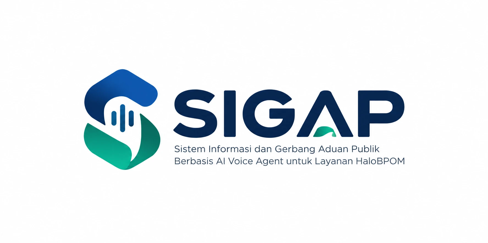
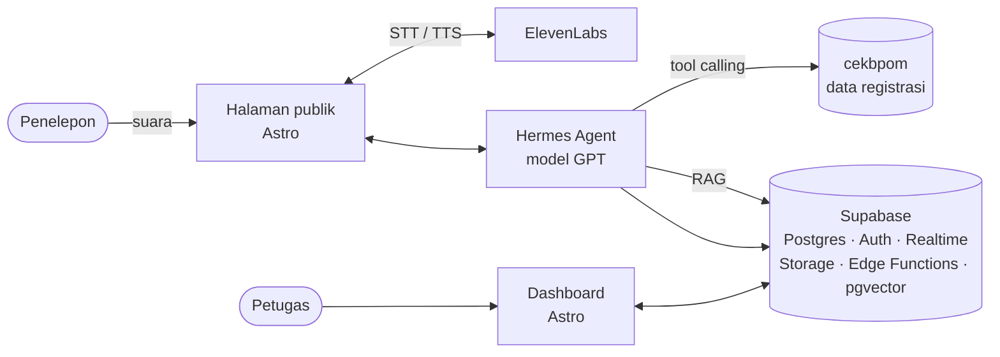

<div align="center">



<p><strong>AI Voice Agent untuk layanan HaloBPOM</strong><br>
Jawaban instan bersumber resmi untuk masyarakat, antrean yang hanya berisi kasus yang benar-benar butuh petugas.</p>

<p>
  
  
  
  
  
</p>

<p>
  <a href="#tentang">Tentang</a> ·
  <a href="#fitur">Fitur</a> ·
  <a href="#arsitektur">Arsitektur</a> ·
  <a href="#memulai">Memulai</a> ·
  <a href="#dokumentasi">Dokumentasi</a> ·
  <a href="#kontribusi">Kontribusi</a>
</p>

</div>

---

## Tentang

**SIGAP** (Sistem Informasi dan Gerbang Aduan Publik) adalah agen suara berbasis AI untuk kanal HaloBPOM milik Badan Pengawas Obat dan Makanan. Masyarakat cukup menekan tombol **"Telepon CS AI"** di situs HaloBPOM, lalu berbicara langsung dengan agen yang:

- menjawab **legalitas produk** dari data registrasi resmi BPOM lewat *tool calling*, bukan dibangkitkan model;
- menjawab **pertanyaan edukasi** obat dan makanan dari basis pengetahuan, lengkap dengan sumber rujukannya;
- **mencatat pengaduan** produk dan menerbitkan nomor tiket;
- **meneruskan ke petugas** pertanyaan yang butuh penilaian manusia, seperti nasihat medis.

Petugas HaloBPOM memakai **dashboard web** untuk memantau layanan secara live, membaca transkrip, menangani pengaduan sampai tiket ditutup, mengelola basis pengetahuan, dan mengunduh laporan.

> [!NOTE]
> Proyek ini dikembangkan untuk mata kuliah Agile Pemerintahan Digital 2026 dan saat ini berada di **Sprint 1**. Belum ditujukan untuk produksi.

## Fitur

Lingkup versi pertama mengikuti delapan use case SRS v1.0.

| Kode | Fitur | Pengguna | Sprint |
|---|---|---|:---:|
| UC-01 | Menanyakan informasi produk (legalitas dan edukasi) | Penelepon | 1 |
| UC-03 | Login dashboard | Petugas | 1 |
| UC-07 | Mengelola basis pengetahuan | Petugas | 1 |
| UC-02 | Menyampaikan pengaduan produk | Penelepon | 2 |
| UC-04 | Memantau layanan dan status AI Agent | Petugas | 2 |
| UC-05 | Membaca transkrip percakapan | Petugas | 3 |
| UC-06 | Menangani pengaduan sampai tiket ditutup | Petugas | 3 |
| UC-08 | Merekap dan mengunduh laporan (PDF/CSV) | Petugas | 3 |

**Di luar lingkup:** nasihat medis otomatis, keputusan tindak lanjut pengaduan secara otomatis, integrasi telepon PSTN 1500533, manajemen akun petugas, dan bahasa selain Indonesia.

## Arsitektur



| Lapisan | Teknologi | Peran |
|---|---|---|
| Frontend | [Astro](https://astro.build) | Halaman publik dengan panel panggilan dan dashboard petugas |
| Backend | [Supabase](https://supabase.com) | Basis data, autentikasi, pembaruan live, ekspor laporan, REST API, indeks vektor basis pengetahuan |
| AI Agent | Hermes Agent + GPT | Pengenalan maksud, RAG, tool calling ke cekbpom |
| Suara | [ElevenLabs](https://elevenlabs.io) | Speech-to-text dan text-to-speech bahasa Indonesia, streaming |

LLM, STT, TTS, cekbpom, dan SMS diakses lewat **adapter dengan implementasi tiruan**, sehingga penyedia bisa diganti tanpa menyentuh kode use case. Kode mengikuti pola **Boundary–Control–Entity**. Alasan lengkap pemilihan stack ada di [ADR 0001](docs/decisions/0001-stack.md).

### Target kualitas

| Aspek | Target |
|---|---|
| Respons suara | ≤ 3 detik setelah penelepon selesai bicara (95% interaksi) |
| Cek registrasi produk | ≤ 5 detik |
| Muat halaman dashboard | ≤ 3 detik pada 10 Mbps |
| Kapasitas | ≥ 50 panggilan serentak |
| Ketersediaan | ≥ 99% selama jam layanan |
| Keamanan | Password di-hash, sesi habis setelah 30 menit tidak aktif, Row Level Security di setiap tabel, TLS 1.2+, data pribadi disamarkan di server (UU No. 27 Tahun 2022) |

## Memulai

### Prasyarat

- Node.js 22.22 atau lebih baru
- npm

### Instalasi

```bash
git clone https://github.com/AgilePemdigi-2026/SigapBPOM.git
cd SigapBPOM
npm install
bash scripts/setup-hooks.sh
```

`setup-hooks.sh` wajib dijalankan sekali setelah clone untuk mengaktifkan git hooks bersama tim.

### Perintah

| Perintah | Fungsi |
|---|---|
| `npm run dev` | Menjalankan server pengembangan di `http://localhost:4321` |
| `npm run build` | Membuat build produksi ke folder `dist/` |
| `npm run preview` | Menjalankan hasil build secara lokal |

Kunci ElevenLabs, OpenAI, dan Supabase hanya diberikan lewat environment variable dan didokumentasikan di `.env.example` (menyusul saat integrasi backend). Jangan pernah meng-commit berkas `.env`.

## Struktur Proyek

```text
SigapBPOM/
├── docs/
│   ├── prd/            # PRD, daftar fitur, spesifikasi, dan backlog tugas
│   ├── reference/      # Rincian REQ, kamus pesan sistem, label UI
│   ├── decisions/      # Architecture Decision Records
│   ├── source/         # SRS v1.0 dan Sprint Planning (dokumen resmi)
│   └── PROJECT_RULES.md
├── scripts/            # Skrip utilitas, termasuk setup git hooks
├── src/
│   ├── components/     # Komponen Astro
│   ├── layouts/        # Layout dasar dan dashboard
│   ├── lib/            # Data dan logika pendukung
│   ├── pages/          # Halaman (login, ringkasan, basis pengetahuan, dst.)
│   └── styles/         # CSS global
└── astro.config.mjs
```

## Dokumentasi

| Dokumen | Isi |
|---|---|
| [SRS v1.0](docs/source/SRS-SIGAP-v1.0.docx) | Spesifikasi kebutuhan resmi, acuan tertinggi |
| [PRD](docs/prd/PRD.md) | Ringkasan kebutuhan untuk pengembang |
| [PRD rinci](docs/reference/PRD-rinci.md) | Kode REQ/NFR/BR, kamus pesan, dan label UI yang wajib dipakai persis |
| [Sprint Planning](docs/source/Sprint-Planning-Sprint-1.docx) | Rencana Sprint 1 |
| [ADR 0001](docs/decisions/0001-stack.md) | Keputusan stack teknologi |
| [Aturan Proyek](docs/PROJECT_RULES.md) | Aturan kontribusi, git, dan arsitektur |

## Kontribusi

Baca [Aturan Proyek](docs/PROJECT_RULES.md) sebelum berkontribusi. Ringkasnya:

1. Kebutuhan berubah di PRD dulu, lewat PR terpisah, baru kode menyusul.
2. Teks UI dan pesan sistem harus persis seperti di [PRD rinci](docs/reference/PRD-rinci.md).
3. Setiap perubahan bisa ditelusuri ke kode kebutuhan (REQ-x.y, NFR-x, BR-x), sebutkan di deskripsi PR.
4. Commit memakai identitas pribadi tiap anggota tim dan mengikuti format [Conventional Commits](https://www.conventionalcommits.org), misalnya `feat(uc-04): ...`.
5. Buat branch dari `main` dan ajukan pull request untuk direview.

---

<div align="center">
  <br>
  <sub>SIGAP · Agile Pemerintahan Digital 2026</sub>
</div>
