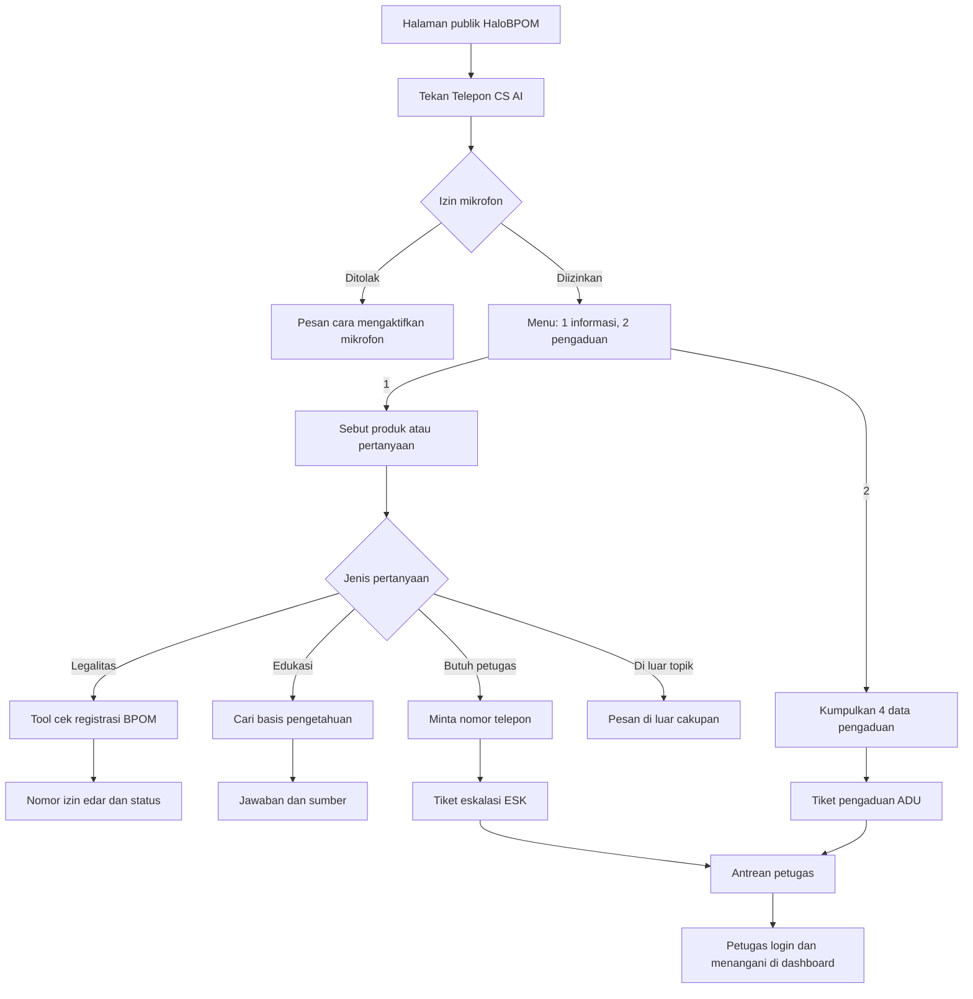
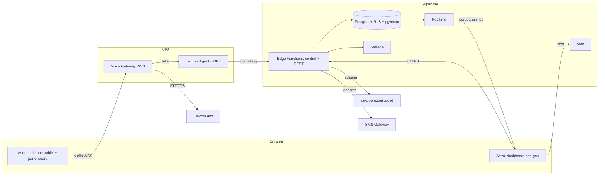
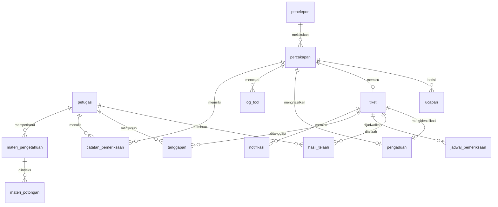

# PRD — Project Requirements Document

## Overview

SIGAP (Sistem Informasi dan Gerbang Aduan Publik) adalah AI Voice Agent untuk kanal HaloBPOM milik Badan Pengawas Obat dan Makanan. Masyarakat menekan tombol "Telepon CS AI" di situs HaloBPOM lalu berbicara langsung dengan agen suara yang menjawab legalitas produk dari data registrasi resmi BPOM, menjawab pertanyaan edukasi obat dan makanan dari basis pengetahuan beserta sumbernya, mencatat pengaduan produk dengan nomor tiket, dan meneruskan pertanyaan yang butuh penilaian manusia, seperti nasihat medis, kepada petugas. Masalah yang diselesaikan adalah antrean petugas yang tersumbat oleh pertanyaan rutin yang sebenarnya bisa dijawab dari data publik, serta pengaduan yang masuk dengan data tidak lengkap.

Pengguna terdiri atas dua kelas. Penelepon adalah masyarakat umum tanpa login dengan literasi digital beragam, sehingga menu suara hanya dua pilihan dan bahasanya sehari-hari. Petugas HaloBPOM memakai dashboard web setiap hari kerja untuk memantau layanan, membaca transkrip, menangani pengaduan sampai tiket ditutup, mengelola basis pengetahuan, dan mengunduh laporan; sebagian petugas memiliki hak ekspor data. Nilai utama produk adalah jawaban instan yang bersumber resmi bagi penelepon, dan antrean yang hanya berisi kasus yang benar-benar butuh petugas.

Versi pertama dibatasi pada delapan use case SRS v1.0 (UC-01 sampai UC-08) ditambah tampilan status AI Agent di dashboard. Di luar lingkup: nasihat medis otomatis, keputusan tindak lanjut pengaduan secara otomatis, integrasi telepon PSTN 1500533, manajemen akun petugas, dan bahasa selain Indonesia. Dokumen ini adalah turunan SRS v1.0 (`docs/source/SRS-SIGAP-v1.0.docx`) dan ADR 0001 (`docs/decisions/0001-stack.md`); bila berbeda, SRS menang. Rincian REQ, kamus pesan sistem, serta label tombol dan field ada di `docs/reference/PRD-rinci.md` dan wajib dipakai persis.

Asumsi yang diambil: level pengalaman tim menengah; akses resmi ke cekbpom.pom.go.id belum pasti sehingga adapter cekbpom wajib punya implementasi tiruan berbasis data contoh; SMS Gateway belum tersedia sehingga notifikasi memakai adapter "log saja"; format nomor tiket mengikuti contoh SRS (ADU-0456, ESK-0123) sampai ditetapkan; dan arah visual dashboard menunggu pilihan opsi desain di Figma.

## Requirements

Kebutuhan fungsional penelepon: sistem memutar menu "Tekan 1 untuk informasi produk, tekan 2 untuk pengaduan." setelah tombol "Telepon CS AI" ditekan, menampilkan transkrip ucapan secara langsung, mencari nomor izin edar dan status izin lewat tool calling (bukan dibangkitkan model), meminta ulang nama produk yang kurang jelas paling banyak dua kali, menyebutkan paling banyak tiga kandidat bila hasil ganda, menjawab edukasi beserta sumber rujukan, menolak pertanyaan di luar topik obat dan makanan, meneruskan pertanyaan yang butuh petugas dengan nomor tiket eskalasi, serta mengumpulkan nama produk, kronologi, nama, dan nomor telepon sebelum menerbitkan tiket pengaduan. Panggilan pengaduan yang diakhiri sebelum data lengkap disimpan tanpa tiket.

Kebutuhan fungsional petugas: login dengan email dan password, akun dikunci sementara setelah tiga kali gagal berturut-turut; melihat ringkasan layanan, panggilan berjalan secara live, antrean tiket eskalasi, dan status AI Agent; membaca transkrip dengan data pribadi tersamarkan dan menyimpan catatan pemeriksaan; menangani pengaduan lewat telaah, jadwal pemeriksaan, tanggapan resmi, hingga tutup tiket yang mengirim SMS; mengelola materi basis pengetahuan dengan rujukan sumber wajib dan penonaktifan tanpa hapus permanen; serta merekap layanan per periode dan mengunduh laporan PDF atau CSV bila punya hak ekspor.

Kebutuhan non-fungsional performa: jawaban suara mulai paling lambat 3 detik setelah penelepon selesai bicara pada 95% interaksi, cek registrasi paling lambat 5 detik, halaman dashboard termuat paling lambat 3 detik pada 10 Mbps, sistem melayani paling sedikit 50 panggilan serentak, dan rekap satu bulan tersaji paling lambat 10 detik. Ketersediaan minimal 99% selama jam layanan.

Kebutuhan non-fungsional keselamatan dan keamanan: sistem tidak memberi nasihat medis, tidak menyebut status legalitas produk yang tidak ditemukan, dan tidak mengambil keputusan tindak lanjut pengaduan. Password di-hash, sesi berakhir setelah 30 menit tanpa aktivitas, data pribadi pelapor disamarkan di server sebelum dikirim ke dashboard, unduh laporan hanya untuk petugas berhak ekspor, setiap tabel dijaga Row Level Security, dan seluruh komunikasi memakai TLS 1.2 atau lebih baru. Pengolahan data pribadi mematuhi UU Nomor 27 Tahun 2022; karena Supabase belum memiliki region Indonesia, lokasi penyimpanan harus dikonfirmasi atau Supabase di-self-host di server Indonesia sebelum produksi.

Kebutuhan non-fungsional bahasa dan aksesibilitas: seluruh UI dan pesan sistem memakai bahasa Indonesia baku persis seperti kamus pesan di `docs/reference/PRD-rinci.md`, transkrip langsung tampil di panel agar penelepon dengan gangguan pendengaran tetap bisa membaca jawaban, kontras teks minimal 4,5:1, seluruh kontrol bisa dioperasikan dengan keyboard, dan pembaruan live dapat dijeda. Kode dipisahkan menurut pola Boundary, Control, Entity, dan setiap use case punya skenario penerimaan Gherkin.

## Core Features

**Tanya Info Produk** adalah nilai utama SIGAP. Penelepon membuka panel panggilan suara, memilih menu 1, lalu menanyakan nama produk atau topik edukasi. Agen mencari data registrasi BPOM lewat tool calling dan menyebutkan nomor izin edar serta statusnya, menangani hasil ganda dan nama yang kurang jelas, menjawab edukasi dari materi aktif beserta sumbernya, menolak topik di luar cakupan, dan meneruskan pertanyaan medis ke petugas dengan tiket eskalasi.

**Kelola Pengetahuan** memungkinkan petugas menjaga sumber jawaban AI tetap mutakhir. Petugas melihat daftar materi, menambah materi baru yang wajib memiliki rujukan sumber dan langsung diindeks untuk pencarian, menonaktifkan materi usang tanpa menghapusnya, dan menelusuri graf pengetahuan untuk melihat keterkaitan antarmateri serta bagian dokumen yang terindeks.

**Masuk Dashboard** mengautentikasi petugas dengan email dan password, menampilkan pesan baku untuk isian kosong dan kredensial salah, mengunci akses sementara setelah tiga kali gagal berturut-turut, mengakhiri sesi setelah 30 menit tanpa aktivitas, dan menyediakan kerangka navigasi dashboard yang dipakai semua halaman petugas.

**Sampaikan Pengaduan** memandu penelepon yang memilih menu 2 untuk menyebutkan nama produk, kronologi, nama, dan nomor telepon, menanyakan kembali data yang kurang, menerbitkan nomor tiket pengaduan begitu lengkap, meneruskan berkas ke antrean petugas, dan menyimpan percakapan sebagai pengaduan tidak lengkap bila panggilan berakhir lebih dulu.

**Pantau Layanan** memberi petugas gambaran kondisi layanan saat ini: ringkasan statistik dan kasus perlu tindak lanjut, daftar panggilan berjalan yang diperbarui otomatis beserta tahap pemrosesan AI, antrean tiket eskalasi dengan tautan transkrip, serta status AI Agent yang mencakup kesehatan komponen, latensi respons, dan log pemanggilan tool.

**Tangani Pengaduan** memfasilitasi petugas memproses pengaduan dari telaah dengan pilihan tindak lanjut (telaah dokumen, perlu pemeriksaan lapangan, bukan kewenangan BPOM), penjadwalan pemeriksaan dengan unit pelaksana, penyusunan tanggapan resmi, hingga penutupan tiket yang mengirim SMS kepada pelapor. Tiket tidak bisa ditutup sebelum tanggapan tersimpan.

**Baca Transkrip** menampilkan riwayat percakapan per periode beserta jenis dan status penyelesaiannya, membuka transkrip lengkap dengan ringkasan AI dan data pribadi tersamarkan, serta menyimpan catatan pemeriksaan petugas yang wajib diisi.

**Unduh Laporan** menghitung jumlah panggilan, kasus tereskalasi, dan pengaduan selesai pada periode yang dipilih, menyajikannya dalam grafik dan tabel per minggu, dan menyusun berkas PDF atau CSV hanya untuk petugas yang memiliki hak akses ekspor.

## User Flow

Alur utama dimulai ketika penelepon membuka halaman publik HaloBPOM dan menekan tombol "Telepon CS AI". Browser meminta izin mikrofon, panel panggilan suara terbuka, dan agen memutar menu dua pilihan. Penelepon menekan 1 lalu menyebut "Susu Formula Sehat"; ucapannya tampil di transkrip langsung, agen memanggil tool cek registrasi, dan dalam beberapa detik penelepon mendengar serta membaca nomor izin edar dan status izinnya. Nilai pertama tercapai di titik ini tanpa penelepon perlu login atau menunggu petugas. Bila pertanyaannya edukasi, agen menjawab dengan sumber; bila menyangkut nasihat medis, agen meminta nomor telepon dan menerbitkan tiket eskalasi.

Alur sekunder penelepon adalah pengaduan lewat menu 2: agen menanyakan empat data wajib, menanyakan ulang yang kurang, lalu menyebutkan nomor tiket pengaduan dan memberi tahu tindak lanjut akan dikirim lewat SMS. Alur petugas dimulai dari halaman login, berlanjut ke Ringkasan Layanan, lalu bercabang ke Panggilan Berjalan, Tiket Eskalasi, Riwayat Percakapan, Daftar Pengaduan, Basis Pengetahuan, Rekap dan Laporan, serta AI Agent. Penanganan pengaduan berakhir saat petugas menutup tiket dan SMS terkirim.

## Architecture

SIGAP memakai arsitektur berlapis. Lapisan presentasi adalah aplikasi Astro yang memuat halaman publik dengan panel panggilan suara dan dashboard petugas; batas layer frontend ada di sini, termasuk komponen interaktif panel dan tabel live. Lapisan layanan suara terdiri atas Voice Gateway, sebuah layanan Node kecil yang menerima audio mikrofon dari browser lewat WebSocket Secure, meneruskannya ke ElevenLabs Speech-to-Text secara streaming, mengirim teks ke Hermes Agent, lalu mengalirkan balik suara dari ElevenLabs Text-to-Speech. Hermes Agent menjalankan model GPT melalui langganan, menyusun jawaban, dan memanggil tool SIGAP.

Batas layer backend adalah Supabase. Edge Functions berperan sebagai lapisan control dan REST API untuk tool agen (cek registrasi, cari basis pengetahuan, terbitkan tiket, catat pengaduan) dan untuk aksi dashboard yang butuh aturan bisnis (login dengan penguncian, tutup tiket, ekspor laporan). Postgres menyimpan seluruh register layanan dengan Row Level Security, pgvector menyimpan potongan materi untuk RAG, Realtime mengalirkan perubahan panggilan berjalan dan antrean ke dashboard, Auth menangani sesi petugas, dan Storage menyimpan berkas laporan. Layanan eksternal cekbpom.pom.go.id, ElevenLabs, model GPT, dan SMS Gateway selalu diakses lewat adapter yang memiliki implementasi tiruan, sehingga penyedia bisa diganti tanpa menyentuh kode use case. Kunci `service_role` hanya dipakai di Edge Functions dan Voice Gateway, tidak pernah di browser.

## Database Schema

**petugas** menyimpan akun layanan yang terhubung ke `auth.users`: `id uuid` (sama dengan id auth), `nama text`, `email text unik`, `hak_ekspor boolean`, `gagal_login int`, `terkunci_sampai timestamptz`, dan `aktif boolean`. Fungsi helper `is_petugas()` dipakai kebijakan RLS seluruh tabel dashboard.

**penelepon** menyimpan identitas pelapor yang hanya dibuka oleh Edge Functions: `id uuid`, `no_telp text`, `nama_pelapor text`, `nik_pelapor text nullable`. Dashboard tidak pernah membaca tabel ini langsung; tampilan memakai view `penelepon_tersamar` yang mengembalikan nama dan nomor yang sudah disamarkan.

**percakapan** merekam setiap sesi panggilan: `id uuid`, `penelepon_id uuid nullable`, `waktu_mulai timestamptz`, `waktu_selesai timestamptz nullable`, `jenis_interaksi enum (informasi_produk, pengaduan)`, `status_penyelesaian enum (berjalan, selesai_ai, dieskalasi, tiket_terbit, pengaduan_tidak_lengkap)`, `tahap_ai text`, `topik text`, `ringkasan text`. Indeks pada `waktu_mulai` dan `status_penyelesaian`. Tabel **ucapan** menyimpan transkrip per baris: `percakapan_id`, `urutan int`, `pembicara enum (sistem, penelepon)`, `teks text`, `detik_ke int`.

**tiket** mencatat nomor yang diterbitkan: `id uuid`, `no_tiket text unik` (ADU-xxxx atau ESK-xxxx), `jenis enum (pengaduan, eskalasi)`, `percakapan_id`, `ringkasan text`, `status enum (belum_ditelaah, sedang_ditelaah, menunggu_pemeriksaan, tanggapan_disusun, selesai, diteruskan)`, `tgl_terbit timestamptz`. **pengaduan** menyimpan berkas aduan: `id uuid`, `tiket_id nullable`, `percakapan_id`, `nama_produk text`, `kronologi text`, `kelengkapan boolean`, `tgl_pengaduan timestamptz`.

**hasil_telaah** (`tiket_id`, `petugas_id`, `keputusan enum (telaah_dokumen, pemeriksaan_lapangan, bukan_kewenangan)`, `catatan text`, `tgl_telaah`), **jadwal_pemeriksaan** (`tiket_id`, `tgl_pemeriksaan date`, `unit_pelaksana text`, `status`), **tanggapan** (`tiket_id`, `petugas_id`, `isi text`, `tgl_tanggapan`), **notifikasi** (`tiket_id`, `isi text`, `status_kirim enum`, `tgl_kirim`), dan **catatan_pemeriksaan** (`percakapan_id`, `petugas_id`, `isi text not null`, `waktu`) merekam penanganan oleh petugas. Constraint memastikan tiket tidak berpindah ke `selesai` tanpa baris tanggapan.

**materi_pengetahuan** menyimpan materi edukasi: `id uuid`, `judul text not null`, `isi text`, `kategori text`, `rujukan_sumber text not null`, `status enum (aktif, tidak_aktif)`, `diperbarui_oleh uuid`, `tgl_pemutakhiran timestamptz`. **materi_potongan** menyimpan potongan terindeks untuk RAG: `materi_id`, `urutan int`, `teks text`, `embedding vector(1536)` dengan indeks HNSW; pencarian hanya mengambil potongan dari materi berstatus aktif. **log_tool** merekam pemanggilan tool agen untuk halaman AI Agent: `percakapan_id`, `nama_tool text`, `durasi_ms int`, `berhasil boolean`, `waktu`.

## Tech Stack

Frontend memakai Astro dengan TypeScript sesuai ADR 0001. Halaman dirender di server, sedangkan bagian interaktif seperti panel panggilan suara, tabel live, dan formulir memakai island komponen. Pilihan ini cocok untuk tim menengah karena halaman publik tetap ringan dan dashboard cukup interaktif tanpa SPA penuh. Ikon memakai Lucide, dan token warna serta tipografi mengikuti file Figma tim "SIGAP · UI/UX Design".

Backend memakai Supabase: Edge Functions (Deno, TypeScript) untuk lapisan control dan REST API, Auth untuk sesi petugas dengan penguncian akun buatan sendiri, Realtime untuk dashboard live, dan Storage untuk berkas laporan. Layanan agen terdiri atas Hermes Agent dengan model GPT melalui langganan dan Voice Gateway Node yang memakai ElevenLabs API premium untuk Speech-to-Text dan Text-to-Speech streaming. Karena model diakses lewat langganan, syarat layanan dan kuotanya wajib dipastikan di Sprint 1; adapter LLM memungkinkan beralih ke OpenAI API tanpa mengubah use case.

Database adalah Postgres milik Supabase dengan ekstensi pgvector untuk indeks basis pengetahuan dan Row Level Security di setiap tabel. Migrasi dikelola lewat Supabase CLI. Selama pengembangan dipakai Supabase Cloud region Singapura; sebelum produksi, lokasi data dikonfirmasi ke dosen atau BPOM atau Supabase di-self-host di server Indonesia.

Deployment: aplikasi Astro, Voice Gateway, dan Hermes Agent berjalan di satu VPS Linux di Indonesia dengan Docker dan Nginx sebagai reverse proxy HTTPS dan WSS, sedangkan Supabase dikelola terpisah. Uji penerimaan memakai skenario Gherkin dari SRS Appendix F; kerangkanya (misalnya Playwright dengan Cucumber) ditetapkan lewat ADR berikutnya karena Behat tidak cocok dengan stack TypeScript.
